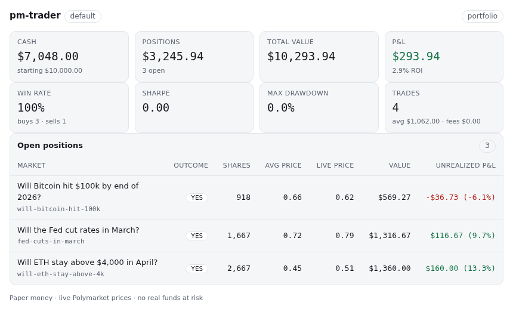
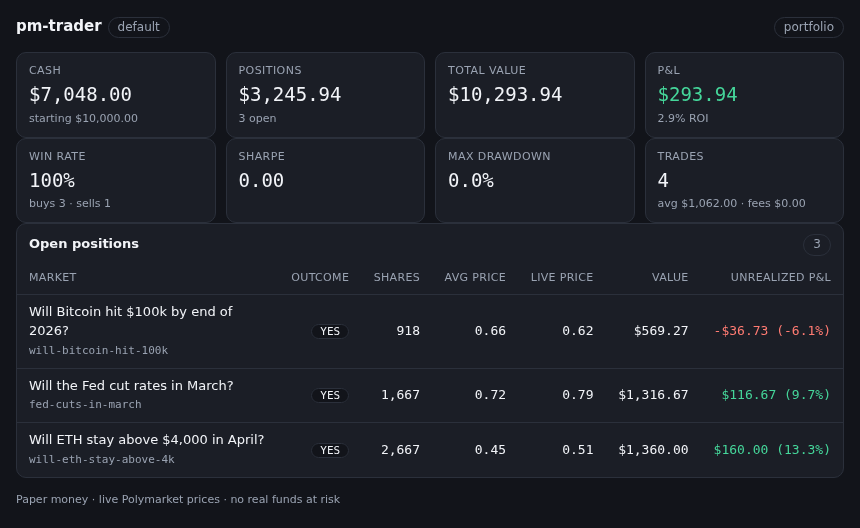

# Integrations

Copy-paste configuration for running `pm-trader-mcp` (MCP server) and/or the
`polymarket-paper-trader` Agent Skill in every major agent runtime.

```bash
pip install polymarket-paper-trader   # or: uvx --from polymarket-paper-trader pm-trader-mcp
pm-trader-mcp                          # stdio transport
```

## Shared stdio config

Most runtimes take the same JSON `mcpServers` entry:

```json
{
  "mcpServers": {
    "polymarket-paper-trader": {
      "command": "uvx",
      "args": ["--from", "polymarket-paper-trader", "pm-trader-mcp"]
    }
  }
}
```

Used, verbatim or under a different root key, by: **Cline** (`cline_mcp_settings.json`),
**Windsurf** (`~/.codeium/windsurf/mcp_config.json`), **LangChain**
(`langchain-mcp-adapters`, add `"transport": "stdio"`), **OpenAI Agents SDK**
(`MCPServerStdio(params={...})`), and **CrewAI** (`StdioServerParameters(...)`).
**GitHub Copilot** (`.vscode/mcp.json`) uses the same shape under `servers` instead of
`mcpServers`. **OpenCode** (`opencode.json`) uses `{"mcp": {"polymarket-paper-trader":
{"type": "local", "command": ["uvx", "--from", "polymarket-paper-trader", "pm-trader-mcp"],
"enabled": true}}}`.

## Claude Code

Plugin (skill + MCP server together):

```
/plugin marketplace add agent-next/polymarket-paper-trader
/plugin install polymarket-paper-trader
```

Reads `.claude-plugin/marketplace.json` + `.claude-plugin/plugin.json` in this repo.
Verified locally: `claude plugin validate . --strict` → `Validation passed`.

MCP server only: `claude mcp add --transport stdio polymarket-paper-trader -- uvx --from polymarket-paper-trader pm-trader-mcp`.
Skill only: see [Agent Skills](#agent-skills) below.

## Codex CLI

```bash
codex mcp add polymarket-paper-trader -- uvx --from polymarket-paper-trader pm-trader-mcp
```

Or add a `[mcp_servers.polymarket-paper-trader]` table to `~/.codex/config.toml`
directly (`command`, `args`). List/inspect with `codex mcp list` / `codex mcp get`.
Skill: Codex reads Agent Skills from `$CODEX_HOME/skills` — install with
`npx skills add agent-next/polymarket-paper-trader`.

## Cursor

[](cursor://anysphere.cursor-deeplink/mcp/install?name=polymarket-paper-trader&config=eyJjb21tYW5kIjoidXZ4IiwiYXJncyI6WyItLWZyb20iLCJwb2x5bWFya2V0LXBhcGVyLXRyYWRlciIsInBtLXRyYWRlci1tY3AiXX0=)

The `config` param is base64 of `{"command":"uvx","args":["--from","polymarket-paper-trader","pm-trader-mcp"]}`.
Skill: `npx skills add agent-next/polymarket-paper-trader`.

## Gemini CLI

```bash
gemini extensions install https://github.com/agent-next/polymarket-paper-trader
```

Reads `gemini-extension.json` at the repo root (bundles the shared `mcpServers` entry
and points `contextFileName` at `skill/polymarket-paper-trader/SKILL.md`, so skill +
server ship together). Manage with `gemini extensions list` / `extensions update`.

## Goose

```bash
goose configure
# Add Extension -> Command-line Extension
#   name: polymarket-paper-trader
#   command: uvx --from polymarket-paper-trader pm-trader-mcp
```

Equivalent `~/.config/goose/config.yaml` entry:

```yaml
extensions:
  polymarket-paper-trader:
    type: stdio
    name: polymarket-paper-trader
    enabled: true
    cmd: uvx
    args: ["--from", "polymarket-paper-trader", "pm-trader-mcp"]
```

## OpenClaw / ClawHub

```bash
npx clawhub install polymarket-paper-trader
```

Installs the skill plus its `metadata.openclaw` block (OpenClaw's current gating key;
`metadata.clawdbot` is kept alongside for older installed copies — OpenClaw prefers
`openclaw` when both are present).

## Hermes Agent (Nous Research)

```bash
hermes mcp add polymarket-paper-trader
# follow the interactive prompt for a stdio server:
#   command: uvx --from polymarket-paper-trader pm-trader-mcp
```

**(unverified)** — the exact config key names written by `hermes mcp add` were not
directly confirmed; the command and stdio-server support are documented.

## Grok / xAI (remote MCP only)

xAI's Remote MCP Tools require Streamable HTTP or SSE — stdio isn't supported. Self-host
instead: `pm-trader-mcp --transport streamable-http --host 127.0.0.1 --port 8765`, then
expose it through an authenticating reverse proxy or tunnel and register that public
`/mcp` URL as a remote MCP tool. The transport has no authentication of its own, so never
bind it directly to a public interface.

## MCP Apps (interactive UI)

`pm-trader-mcp` ships one [MCP Apps](https://modelcontextprotocol.io/docs/extensions/apps)
view: the `portfolio` and `stats` tools return the same JSON envelope as text as
always, and additionally point at a self-contained dashboard
(`ui://pm-trader/portfolio`, `text/html;profile=mcp-app`) through
`_meta.ui.resourceUri` (ChatGPT also reads the `openai/outputTemplate` alias).

Hosts that implement MCP Apps render the dashboard inline instead of the text
result: cash, total value, P&L and ROI, a positions table (market, outcome,
shares, average price, live price, unrealized P&L), and for `stats` win rate,
Sharpe, max drawdown, trade count and fees. The view asks the server for the
totals through the bridge's `tools/call` when the host can proxy tool calls
(`hostCapabilities.serverTools`); hosts that cannot simply get the positions it
already has. Errors from the tool (`{"ok": false, ...}`) and an empty
portfolio both render as a message instead of a table.

The document is one HTML file with inline CSS and vanilla JS — no external
scripts, fonts, images or network calls — and declares no CSP domains, so it
runs under the spec's restrictive default CSP. Light and dark follow the host's
`hostContext.theme` and theme variables, falling back to
`prefers-color-scheme`.

Every other runtime listed above (and any host without MCP Apps support) keeps
getting exactly the same text result it gets today: no configuration change, no
behavior change.





## Agent Skills

The skill at `skill/polymarket-paper-trader/SKILL.md` (mirrored at
`.claude/skills/polymarket-paper-trader/SKILL.md`) follows the open
[Agent Skills specification](https://agentskills.io/specification.md). Install into any
compatible client (Claude Code, Codex, Gemini, Copilot, Cursor, OpenClaw, Hermes) with:

```bash
npx skills add agent-next/polymarket-paper-trader
```

## Sources

- [Claude Code — Plugin manifest reference](https://code.claude.com/docs/en/plugins-reference)
- [Claude Code — Marketplace reference](https://code.claude.com/docs/en/plugins/marketplace-reference)
- [Claude Code — Connect to MCP servers](https://code.claude.com/docs/en/mcp-quickstart)
- [Codex CLI — MCP (developers.openai.com/codex/mcp, redirects to)](https://learn.chatgpt.com/docs/extend/mcp?surface=cli)
- [Cursor Docs — MCP Install Links](https://cursor.com/docs/mcp/install-links)
- [Gemini CLI — Extensions overview](https://cdn.jsdelivr.net/gh/google-gemini/gemini-cli@main/docs/extensions/index.md)
- [Gemini CLI — Extension reference](https://cdn.jsdelivr.net/gh/google-gemini/gemini-cli@main/docs/extensions/reference.md)
- [Goose — Configuration File](https://goose-docs.ai/docs/guides/config-file/) (stdio extension shape verified)
- [Goose — Using Extensions](https://goose-docs.ai/docs/getting-started/using-extensions/)
- [OpenCode — MCP servers](https://opencode.ai/docs/mcp-servers/)
- [Cline Docs — MCP overview](https://docs.cline.bot/mcp/mcp-overview)
- [Windsurf Docs — Cascade MCP Integration](https://docs.windsurf.com/windsurf/cascade/mcp)
- [GitHub Docs — Extending Copilot Chat with MCP](https://docs.github.com/en/copilot/how-tos/provide-context/use-mcp-in-your-ide/extend-copilot-chat-with-mcp)
- [VS Code — MCP configuration reference](https://code.visualstudio.com/docs/agents/reference/mcp-configuration)
- [OpenClaw Docs — Skills](https://docs.openclaw.ai/tools/skills)
- [ClawHub — Skill + Plugin Registry](https://github.com/openclaw/clawhub)
- [Hermes Agent — MCP Config Reference](https://hermes-agent.nousresearch.com/docs/reference/mcp-config-reference) (unverified: exact config keys)
- [xAI Docs — Remote MCP Tools](https://docs.x.ai/developers/tools/remote-mcp)
- [LangChain — `langchain-mcp-adapters`](https://github.com/langchain-ai/langchain-mcp-adapters)
- [OpenAI Agents SDK — MCP](https://openai.github.io/openai-agents-python/mcp/)
- [CrewAI Docs — Stdio Transport](https://docs.crewai.com/v1.15.20/en/mcp/stdio)
- [Agent Skills — Specification](https://agentskills.io/specification.md)
- [MCP Apps — Specification](https://modelcontextprotocol.io/docs/extensions/apps)
  (`ui://` resources, `_meta.ui.resourceUri`, the postMessage JSON-RPC bridge)
